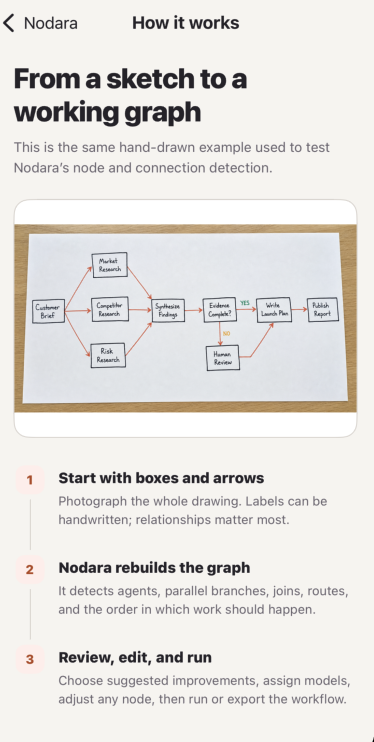
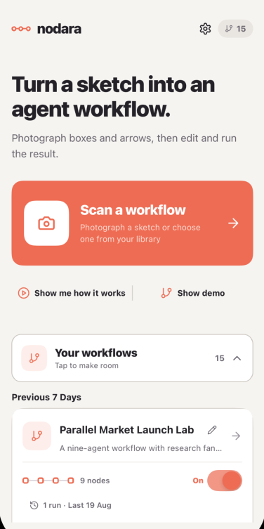
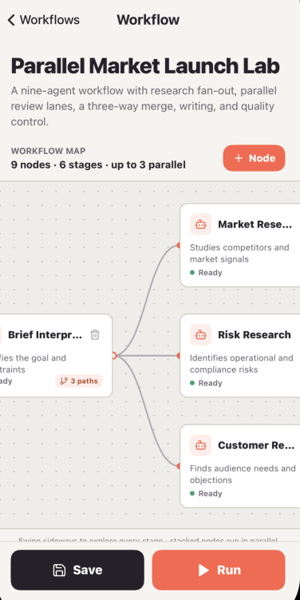
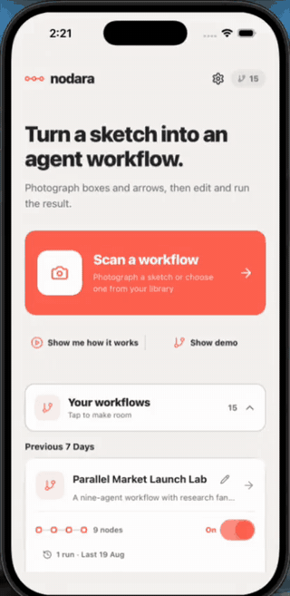
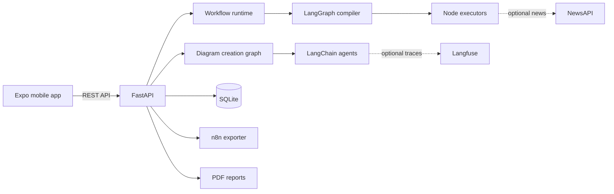

# Nodara

Turn a hand-drawn workflow into an executable multi-agent system.

Nodara is a mobile-first, open-source workflow builder for people who want to design AI automations visually. Photograph boxes and arrows, review the detected graph, refine each agent, choose models, schedule runs, inspect execution history, and export the result to n8n.

> [!IMPORTANT]
> Nodara is an active proof of concept. Review generated prompts and workflow behavior before using it with production data or external systems.

## Product tour

<table>
  <tr>
    <td align="center"><strong>Learn from a real sketch</strong></td>
    <td align="center"><strong>Scan or explore saved workflows</strong></td>
    <td align="center"><strong>Edit the generated workflow</strong></td>
  </tr>
  <tr>
    <td></td>
    <td></td>
    <td></td>
  </tr>
</table>

## See Nodara in action

<p align="center">
  
</p>

## What Nodara can do

- Convert a photographed workflow sketch into nodes, edges, parallel branches, and loops.
- Validate whether an image is a usable diagram before building a workflow.
- Review graph logic and present selectable recommendations instead of silently changing it.
- Generate and refine instructions for every agent through a decomposed LangChain pipeline.
- Execute generated workflows through a separate LangGraph runtime.
- Use a backend default model, a global mobile preference, or a per-node override.
- Schedule workflows for a specific time, interval, or time window.
- Store run inputs, node outputs, final results, errors, and timestamps.
- Export one run or complete workflow history as a PDF report.
- Export workflow topology and supported integrations to n8n.
- Trace LLM activity with optional Langfuse integration.
- Use a bundled complex demo without configuring an LLM.

## Architecture



| Area | Technology |
|---|---|
| Mobile | React Native, Expo Router, TypeScript |
| API | Python 3.12+, FastAPI, Pydantic |
| Agent creation | LangChain, structured response models |
| Workflow execution | LangGraph |
| Persistence | SQLAlchemy, SQLite |
| Observability | Langfuse, optional |
| Reports | ReportLab PDF |

The creation pipeline and execution runtime are intentionally separate. The creation graph interprets and validates a diagram. The runtime compiles the saved workflow into an executable graph.

## Repository layout

```text
.
├── backend/
│   ├── api/v1/                 # FastAPI routes and request schemas
│   ├── core/                   # Settings, startup, and API security
│   ├── libs/langchain/         # Creation chains, prompts, response models
│   ├── libs/langgraph/         # Workflow compiler and executor
│   ├── libs/runtime/           # Node execution and external sources
│   ├── libs/database/          # SQLAlchemy models and repositories
│   ├── libs/n8n/               # n8n conversion
│   ├── libs/reports/           # Run-history PDF reports
│   └── tests/                  # Backend test suite
├── mobile/
│   ├── app/                    # Expo Router screens
│   ├── components/             # Reusable mobile UI
│   ├── services/               # API and local settings clients
│   └── types/                  # TypeScript domain models
└── .github/                    # CI and contribution templates
```

## Quick start

### Requirements

- Python 3.12+
- Node.js 18+ and npm
- Expo Go on a physical device, or an Android/iOS simulator

### 1. Start the backend

```bash
cd backend
python3 -m venv .venv
source .venv/bin/activate
pip install -r requirements.txt
cp .env.example .env
python -m uvicorn main:app --host 0.0.0.0 --port 8000 --reload
```

The local API is available at:

- API: `http://localhost:8000`
- OpenAPI: `http://localhost:8000/docs`
- Health check: `http://localhost:8000/health`

Nodara can start with `USE_MOCK_AI_FALLBACK=true`, so contributors can explore the demo before adding an API key.

### 2. Start the mobile app

```bash
cd mobile
npm install
cp .env.example .env
npm start
```

For a physical phone, replace `localhost` in `mobile/.env` with the computer's LAN address:

```env
EXPO_PUBLIC_API_URL=http://192.168.1.50:8000
```

Keep the phone and development computer on the same network, then scan the Expo QR code.

### iOS simulator setup

The iOS simulator requires a complete Xcode command-line installation. If Expo reports that `xcrun` is not configured, open Xcode once, accept its license, install the requested components, and select the installed Xcode version:

```bash
sudo xcode-select --switch /Applications/Xcode.app/Contents/Developer
xcrun simctl list devices
```

## Configuration

Copy `backend/.env.example` to `backend/.env`. Never commit real keys.

| Variable | Required | Purpose |
|---|---:|---|
| `LLM_API_KEY` | For live AI | OpenAI-compatible provider key |
| `LLM_BASE_URL` | No | OpenAI-compatible API base URL |
| `LLM_MODEL` | No | Default text model |
| `VISION_MODEL` | No | Diagram-reading model |
| `USE_MOCK_AI_FALLBACK` | No | Keep local demo behavior available |
| `API_AUTH_TOKEN` | Production | Protect API routes with a bearer token |
| `NEWS_API_KEY` | For news nodes | NewsAPI credential |
| `USE_LANGFUSE` | No | Enable trace collection |
| `LANGFUSE_PUBLIC_KEY` | With Langfuse | Langfuse project public key |
| `LANGFUSE_SECRET_KEY` | With Langfuse | Langfuse project secret key |
| `DATABASE_URL` | No | SQLAlchemy database connection |

The Settings screen can store user-provided model URLs and keys locally on the device. Backend environment variables remain the recommended configuration for shared deployments.

## Tests

Run the backend suite:

```bash
cd backend
source .venv/bin/activate
pytest -q
```

Run the mobile TypeScript check:

```bash
cd mobile
npm run lint
```

The live vision test is opt-in because it calls the configured multimodal provider:

```bash
cd backend
pytest -m live_vision
```

## API overview

The OpenAPI page at `/docs` is the source of truth. Common endpoints include:

| Method | Endpoint | Purpose |
|---|---|---|
| `POST` | `/api/workflows/from-image/jobs` | Start diagram processing with progress stages |
| `GET` | `/api/workflows/from-image/jobs/{job_id}` | Read processing progress and result |
| `GET` | `/api/workflows` | List saved workflows |
| `PATCH` | `/api/workflows/{id}/name` | Rename a workflow |
| `PUT` | `/api/workflows/{id}` | Save graph or agent changes |
| `PUT` | `/api/workflows/{id}/schedule` | Create or update a schedule |
| `POST` | `/api/workflows/{id}/run` | Execute a workflow |
| `GET` | `/api/workflows/{id}/runs` | Read workflow run history |
| `GET` | `/api/runs/{run_id}/report.pdf` | Export one run report |
| `GET` | `/api/workflows/{id}/runs/report.pdf` | Export all run reports |
| `GET` | `/api/workflows/{id}/export/n8n` | Export an n8n workflow |
| `GET` | `/api/models` | Read the backend model catalog and default |

## Contributing

Contributions are welcome, including bug reports, mobile UX improvements, new node executors, provider adapters, tests, documentation, and n8n export coverage.

Read [CONTRIBUTING.md](CONTRIBUTING.md) before opening a pull request. By participating, you agree to follow the [Code of Conduct](CODE_OF_CONDUCT.md). Security issues must follow [SECURITY.md](SECURITY.md), not the public issue tracker.

Good first contributions are labeled `good first issue`. Larger changes should begin with a feature request or discussion so contributors and maintainers can agree on the behavior before implementation.

## Project status and roadmap

Nodara is a proof of concept moving toward a reliable community workflow platform. Current priorities are:

- More production-grade node types and credential adapters.
- Stronger graph validation and execution recovery.
- Database migrations and deployment presets.
- Broader n8n node fidelity.
- End-to-end mobile testing and accessibility coverage.
- Pluggable workflow templates and community examples.

## Security and privacy

- Workflow inputs and outputs may contain sensitive information. Treat the configured database as sensitive.
- API authentication is open when `API_AUTH_TOKEN` is empty. Set it outside local development.
- Use least-privilege provider keys and rotate any credential that has been exposed.
- Langfuse tracing can include prompts and outputs. Review your data-handling requirements before enabling it.

## License

Nodara is available under the [MIT License](LICENSE).

Copyright © 2026 Nodara contributors.
